<!--
  Images in assets/ are generated from data/profile.json by scripts/build-assets.mjs
  (the "Profile assets" workflow re-runs it weekly). Edit the data file, not the SVGs.
  Each image has a dark and a light version; <picture> shows the one matching the viewer's GitHub theme.
-->

<picture>
  <source media="(prefers-color-scheme: dark)" srcset="assets/header-dark.svg" />
  <source media="(prefers-color-scheme: light)" srcset="assets/header-light.svg" />
  
</picture>

 

<picture>
  <source media="(prefers-color-scheme: dark)" srcset="assets/divider-dark.svg" />
  <source media="(prefers-color-scheme: light)" srcset="assets/divider-light.svg" />
  
</picture>

## 👋 About me

Full-stack engineer at **Norsys Africa** in Marrakech, building business applications with
**Java / Spring Boot** on the back-end and **Angular / React** on the front-end for **<!--years-->2+ years<!--/years-->**.

- ⚡ Cut API response times from **18–30 s to under 2 s** on a multi-branch SaaS (JDBC batching, N+1 removal, indexing, pagination).
- 🚀 Designed, built and deployed an e-commerce platform **on my own**, from the first commit to a hardened VPS with CI/CD.
- 🔒 Most of my work lives in **private client repositories**. The pinned repos below are the public side.
- 🌍 Arabic (native) · English (advanced) · French (professional)

<picture>
  <source media="(prefers-color-scheme: dark)" srcset="assets/divider-dark.svg" />
  <source media="(prefers-color-scheme: light)" srcset="assets/divider-light.svg" />
  
</picture>

## 💼 Experience

<picture>
  <source media="(prefers-color-scheme: dark)" srcset="assets/timeline-dark.svg" />
  <source media="(prefers-color-scheme: light)" srcset="assets/timeline-light.svg" />
  
</picture>

<picture>
  <source media="(prefers-color-scheme: dark)" srcset="assets/divider-dark.svg" />
  <source media="(prefers-color-scheme: light)" srcset="assets/divider-light.svg" />
  
</picture>

## 🛠️ Tech stack

  <picture>
    <source media="(prefers-color-scheme: dark)" srcset="https://skillicons.dev/icons?i=java%2Cspring%2Cpostgres%2Cmysql%2Cmongodb%2Celasticsearch&theme=dark" />
    <source media="(prefers-color-scheme: light)" srcset="https://skillicons.dev/icons?i=java%2Cspring%2Cpostgres%2Cmysql%2Cmongodb%2Celasticsearch&theme=light" />
    
  </picture>
    
  <picture>
    <source media="(prefers-color-scheme: dark)" srcset="https://skillicons.dev/icons?i=react%2Cangular%2Cnextjs%2Cts%2Cjs%2Ctailwind%2Cvite&theme=dark" />
    <source media="(prefers-color-scheme: light)" srcset="https://skillicons.dev/icons?i=react%2Cangular%2Cnextjs%2Cts%2Cjs%2Ctailwind%2Cvite&theme=light" />
    
  </picture>
    
  <picture>
    <source media="(prefers-color-scheme: dark)" srcset="https://skillicons.dev/icons?i=docker%2Cnginx%2Cgithubactions%2Cgitlab%2Ccloudflare%2Clinux%2Cgit%2Cidea&theme=dark" />
    <source media="(prefers-color-scheme: light)" srcset="https://skillicons.dev/icons?i=docker%2Cnginx%2Cgithubactions%2Cgitlab%2Ccloudflare%2Clinux%2Cgit%2Cidea&theme=light" />
    
  </picture>

<b>Full stack, libraries and practices</b>

 

| Area | Tools |
|---|---|
| **Languages** | Java (8, 11, 17, 21), TypeScript, JavaScript, SQL, PL/SQL |
| **Back-end** | Spring Boot 3/4 (Security, Web, Data JPA), Spring MVC, JWT, Hibernate, Flyway, WebSocket, Jakarta EE |
| **Front-end** | React 19, Angular 16/19, React Native, RxJS, TanStack Query, Angular Material, PrimeNG, Tailwind CSS |
| **Data** | PostgreSQL, MySQL, Oracle, SQLite, MongoDB, Elasticsearch |
| **DevOps** | Docker, Docker Compose, GitHub Actions, GitLab CI/CD, Nginx, Cloudflare, Linux VPS hardening |
| **Quality** | JUnit 5, Mockito, Postman, SoapUI, code reviews, Agile Scrum |

<picture>
  <source media="(prefers-color-scheme: dark)" srcset="assets/divider-dark.svg" />
  <source media="(prefers-color-scheme: light)" srcset="assets/divider-light.svg" />
  
</picture>

## 🏅 Certifications

<picture>
  <source media="(prefers-color-scheme: dark)" srcset="assets/certifications-dark.svg" />
  <source media="(prefers-color-scheme: light)" srcset="assets/certifications-light.svg" />
  
</picture>

<b>All 28 certificates</b>

 

- **Meta:** React Basics · React Advanced
- **Spring & Java:** Securing Spring Boot 3 with JWT · Getting Started with Spring Boot · Spring Data MongoDB · Microservices with Spring Cloud · Spring Boot S3 File Uploads with React · Java Basic · The Complete Data Structures and Algorithms Course in Java
- **Front-end:** Developing Front-End Apps with React · React JS Tutorial · ReactJS Redux Basics · Flux React.js · Next.js · Tailwind CSS · Angular 7 Intermediate · Angular 7 Advanced · Angular 2 Spotify App · Angular FireStore Workshop
- **DevOps:** Docker for Developers · Dockerize a Spring Boot Application · Introduction to DevOps · Git & GitHub · Git Tutorial
- **SQL:** SQL Basic · SQL Intermediate · SQL Advanced · SQL Intermediate (SoloLearn)

<picture>
  <source media="(prefers-color-scheme: dark)" srcset="assets/divider-dark.svg" />
  <source media="(prefers-color-scheme: light)" srcset="assets/divider-light.svg" />
  
</picture>

## 🧠 Problem solving

<a href="https://leetcode.com/AIZEN001/">
  <picture>
    <source media="(prefers-color-scheme: dark)" srcset="assets/leetcode-dark.svg" />
    <source media="(prefers-color-scheme: light)" srcset="assets/leetcode-light.svg" />
    
  </picture>
</a>

<picture>
  <source media="(prefers-color-scheme: dark)" srcset="assets/divider-dark.svg" />
  <source media="(prefers-color-scheme: light)" srcset="assets/divider-light.svg" />
  
</picture>

## 📊 GitHub activity

<!-- The stats SVGs are regenerated daily by .github/workflows/metrics.yml, the snake by snake.yml -->

<picture>
  <source media="(prefers-color-scheme: dark)" srcset="https://raw.githubusercontent.com/abdellah-belcaid/abdellah-belcaid/output/github-contribution-grid-snake-dark.svg" />
  <source media="(prefers-color-scheme: light)" srcset="https://raw.githubusercontent.com/abdellah-belcaid/abdellah-belcaid/output/github-contribution-grid-snake.svg" />
  
</picture>

<picture>
  <source media="(prefers-color-scheme: dark)" srcset="assets/divider-dark.svg" />
  <source media="(prefers-color-scheme: light)" srcset="assets/divider-light.svg" />
  
</picture>

## 🎓 Education

**Master's in Information Systems Engineering**, Cadi Ayyad University, Marrakech · *2022 – 2024* 
**Bachelor's in Software Engineering (SMI)**, Ibn Zohr University, Agadir · *2019 – 2022*

 

Want to talk about a project? Reach me at <a href="mailto:belcaid.abdellah2001@gmail.com">belcaid.abdellah2001@gmail.com</a>

  

